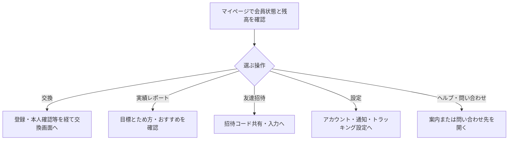

# F18｜マイページ・ヘルプ・問い合わせ PRD（レビュー前）

> ④業務ルールと⑦以降はユーザーレビュー未完了。機能・画面・操作は現在の4189モックを正とし、優先順位はスプレッドシートを正とする。本PRDはTier1のみを定義する。

参照するモック：`Tameruko-Preview-20261013` の4189（2026-10-15確認）。未接続の外部API・実端末機能は、接続済みとして扱わず末尾に記載する。

| 基本情報 | 内容 |
| --- | --- |
| 機能ID | F18 |
| 概要 | マイページ・ヘルプ・問い合わせ |
| 対象領域 | アプリ／管理画面／外部連携 |
| 関連機能 | [F01](F01-account.md)、[F12](F12-points.md)、[F13](F13-point-exchange.md)、[F14](F14-referral.md) |
| 更新日 | 2026-10-15 |
| 版 | レビュー前（初版未確定） |

## ① 目的・今回作る範囲

目的：利用状況を確認し、困ったときに解決へ進めるようにするため

評価指標：問い合わせ率/解決時間/原因別の問い合わせ件数

優先順位は[アプリ詳細要件のTier列](https://docs.google.com/spreadsheets/d/1g00ZxLGprVNT4T4uSmzw--vRpp95HQ1Uq9i8GnJpmS4/edit#gid=1107057215)を正とする。モックに存在してもTier2・Tier3・空欄の要件は本PRDの定義対象に含めない。

| 要件ID | Tier1の範囲 |
| --- | --- |
| F18-1 | マイページで会員状態（未ログイン/ログイン）とポイント残高を確認できる |
| F18-2 | ログイン済みのユーザーが、マイページから好きなポイントへの交換を開始できる |
| F18-3 | 未ログインのユーザーが、マイページからログイン画面に遷移できる |
| F18-4 | マイページの実績レポートボタンから実績レポート・ポイント履歴へ進める |
| F18-5 | ヘルプ・お問い合わせ・プライパシーポリシー・利用規約・アクセスデータの利用を確認でき、外部ページにwebviewで遷移させる |
| F18-6 | トラッキング設定から、"設定"アプリに遷移しトラッキングのステータスを変更できる |
| F18-7 | アカウント情報を確認してプロフィール確認・ログアウト・退会へ進むことができる |

要件名に旧モックとの相違がある場合、優先順位は維持し、現在の表示・動きとユーザー指定を②以降へ反映する。実装方式の具体化は仕様設計で扱う。

## ② 画面イメージ

[アプリの該当画面](http://127.0.0.1:4189/mock-app/#mypage)

- 本人の会員状態・ポイント残高と円相当額・失効予定を確認する。
- 会員は「好きなポイントに交換」、ゲストは会員登録／ログインへ進む。実績レポートのボタンは交換ボタンと同じ横幅にする。
- 友達招待・招待コード入力、ヘルプ・お問い合わせ・アカウント情報の確認・通知設定・トラッキング設定・規約へ進める。

## ③ 操作フロー

## ④ 業務ルール・制約

> ユーザーレビュー未完了。アプリ上の表示に関わるルールを記載する。

### 表示する対象ユーザー

| 対象ユーザー | 利用・表示 |
| --- | --- |
| 会員 | 本人の会員状態・残高と、交換・各設定への入口を表示する |
| 非会員（ゲスト） | 本人の利用状況・残高と、会員登録・ログインへの入口を表示する |

### 表示条件

| 状態・条件 | 表示のルール |
| --- | --- |
| ログイン済み | 主操作として好きなポイントに交換を表示する |
| 非会員 | 主操作として会員登録・ログインを表示する |
| 残高・履歴 | F12の本人データと同じ内容を表示する |

### 画面に置く要素・操作

| 画面・要素 | 表示・操作のルール |
| --- | --- |
| ポイント表示 | 本人のポイントと円相当額、失効予定を表示する |
| 主操作のボタン | 会員状態に応じて交換または認証へ進む |
| 実績レポート | 交換ボタンと同じ横幅で表示し、レポート・ポイント履歴へ進む |
| 友達招待・招待コード入力 | 招待の共有・入力へ進む |
| アカウント・通知・トラッキング設定 | 本人の情報確認と各設定へ進む |
| ヘルプ・お問い合わせ・規約 | 設定された案内・外部ページへ進む |

## ⑤ 管理画面

新規作成・変更・削除は、現在の管理画面で操作できる範囲を示す。「外部管理」はNACS・EDOCODE等の担当範囲、「未実装」は操作画面がない項目。削除と公開停止は分けて記載する。

| 対象項目 | 新規作成 | 変更 | 削除 | 管理画面での操作・反映範囲 |
| --- | --- | --- | --- | --- |
| ヘルプ本文・問い合わせ先・規約リンク | 未実装 | 未実装 | 未実装 | 値や表示はアプリに存在するが、現在の管理画面に専用の編集UIはない。 |
| マイページの残高・履歴・交換先 | 対象外 | 対象外 | 対象外 | F12・F13のデータを表示し、本人の操作で遷移する。 |

## ⑥ 例外処理・エラーハンドリング

| 状況 | 表示・処理・復帰 |
| --- | --- |
| 問い合わせ先未設定・外部ページが開けない | 案内と戻る入口を表示する。送信済みとは扱わない。 |
| ゲスト・未認証の制限操作 | 登録・ログイン・本人確認へ進める。 |

## ⑦ 達成条件・未決事項

> 本節以降はユーザーレビュー未完了。

### Tier1の達成条件

- [ ] F18-1：マイページで会員状態（未ログイン/ログイン）とポイント残高を確認できる。
- [ ] F18-2：ログイン済みのユーザーが、マイページから好きなポイントへの交換を開始できる。
- [ ] F18-3：未ログインのユーザーが、マイページからログイン画面に遷移できる。
- [ ] F18-4：マイページの実績レポートボタンから実績レポート・ポイント履歴へ進める。
- [ ] F18-5：ヘルプ・お問い合わせ・プライパシーポリシー・利用規約・アクセスデータの利用を確認でき、外部ページにwebviewで遷移させる。
- [ ] F18-6：トラッキング設定から、"設定"アプリに遷移しトラッキングのステータスを変更できる。
- [ ] F18-7：アカウント情報を確認してプロフィール確認・ログアウト・退会へ進むことができる。
- [ ] ⑥の対象となる空・失敗・中断などの状態から、表示内容と次の操作を確認できる。

### まだ決まっていないこと

| 確認事項 | 相談先 |
| --- | --- |
| 正式な問い合わせ窓口とヘルプ・規約の公開先 | 事業・運用 |

## モックへの未反映・対象外

### モックへの未反映

| 項目 | 未反映の内容 |
| --- | --- |
| 外部ページ・問い合わせ | 本番の問い合わせ先・ヘルプ・規約ページとの接続は未実施 |
| 案内内容の管理画面 | ヘルプ本文・問い合わせ先・規約リンクを編集する専用画面は未実装 |

### 今回の対象外

| 項目 | 対象外の内容 |
| --- | --- |
| なし | — |

## 変更履歴

| 版 | 日付 | 変更内容 |
| --- | --- | --- |
| レビュー前 | 2026-10-15 | F10レビューの共通フィードバックを反映。⑤を管理画面へ変更し、④を対象ユーザー・表示条件・配置要素に整理。例外処理と仕様設計事項の重複を除き、未反映と対象外を別表に分離。個別レビューは未完了。 |
