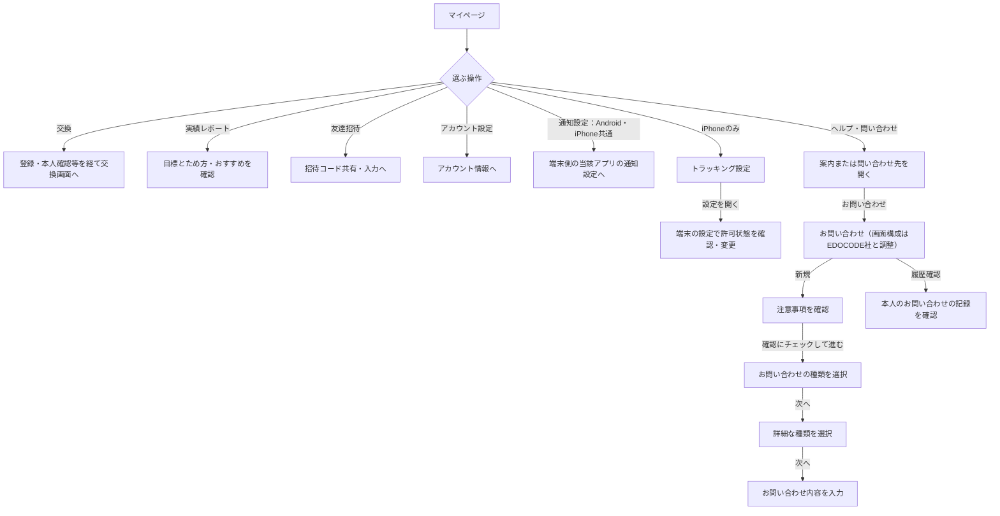

# F18｜マイページ・ヘルプ・問い合わせ PRD（レビュー前）

> 本PRDはユーザーレビュー中。優先順位はスプレッドシートを正とする。本PRDはTier1のみを定義し、決定した仕様とモックの未反映事項を区別する。

参照するモック：本リポジトリの `mock-app/`・`mock-admin/`（2026-10-27確認）。未接続の外部API・実端末機能は、接続済みとして扱わず末尾に記載する。

| 基本情報 | 内容 |
| --- | --- |
| 機能ID | F18 |
| 概要 | マイページ・ヘルプ・問い合わせ |
| 対象領域 | アプリ／管理画面／外部連携 |
| 関連機能 | [F01](F01-account.md)、[F12](F12-points.md)、[F13](F13-point-exchange.md)、[F14](F14-referral.md) |
| 更新日 | 2026-10-29 |
| 版 | 初版未確定（PRDのFIX時を第1版とする） |

## ① 目的・今回作る範囲

目的：利用状況を確認し、困ったときに解決へ進めるようにするため

評価指標：問い合わせ率/解決時間/原因別の問い合わせ件数

優先順位は[アプリ詳細要件のTier列](https://docs.google.com/spreadsheets/d/1tI26I_4vbSHIOzMdJz7g8-DjeLyyVUKoksVHhZ0AQhU/edit#gid=1107057215)を正とする。モックに存在してもTier2・Tier3・空欄の要件は本PRDの定義対象に含めない。

| 要件ID | Tier1の範囲 |
| --- | --- |
| F18-1 | マイページで会員状態（未ログイン/ログイン）とポイント残高を確認できる |
| F18-2 | ログイン済みのユーザーが、マイページから好きなポイントへの交換を開始できる |
| F18-3 | 未ログインのユーザーが、マイページからログイン画面に遷移できる |
| F18-4 | マイページの実績レポートボタンから実績レポート・ポイント履歴へ進める |
| F18-5 | ヘルプ・プライバシーポリシー・利用規約・アクセスデータの利用を外部ページで確認できる。お問い合わせの画面構成はEDOCODE社の仕様に合わせて調整する。新規お問い合わせでは注意事項確認→種類→詳細な種類→内容入力へ進める。通知設定はAndroid・iPhoneともに端末側の当該アプリの通知設定へ進める |
| F18-6 | iPhoneユーザーにのみ「トラッキング設定」を表示し、端末の「設定」アプリでトラッキングの許可状態を確認・変更できるようにする。iPhone以外には表示しない |
| F18-7 | アカウント情報を確認してプロフィール確認・ログアウト・アカウント削除へ進むことができる |

要件名に旧モックとの相違がある場合、優先順位は維持し、現在の表示・動きとユーザー指定を②以降へ反映する。実装方式の具体化は仕様設計で扱う。

## ② 画面イメージ

[マイページ](http://127.0.0.1:4222/mock-app/#mypage)／[お問い合わせ](http://127.0.0.1:4222/mock-app/#contact)

- 本人の会員状態・ポイント残高と円相当額・失効予定を確認する。
- 会員は「好きなポイントに交換」、ゲストは会員登録／ログインへ進む。
- 友達招待・招待コード入力、ヘルプ・お問い合わせ・アカウント情報の確認・通知設定・トラッキング設定・規約へ進める。
- 「トラッキング設定」の入口・案内画面はiPhoneユーザー限定とし、iPhone以外には表示しない。

## ③ 操作フロー

## ④ 業務ルール・制約

> ユーザーレビュー未完了。利用条件と機能の処理に関わるルールを記載する。

### 表示する対象ユーザー

| 対象ユーザー | 利用・表示 |
| --- | --- |
| 会員 | 本人の会員状態・残高と、交換・各設定への入口を表示する |
| 非会員（ゲスト） | 本人の利用状況・残高と、会員登録・ログインへの入口を表示する |

### 表示条件

| 状態・条件 | 表示のルール |
| --- | --- |
| ログイン済み | 主操作として好きなポイントに交換を表示する |
| 非会員 | 主操作として会員登録・ログインを表示する |
| 残高・履歴 | F12の本人データと同じ内容を表示する |
| iPhoneで利用 | 会員・ゲストを問わず「トラッキング設定」を表示する。許可済み・未許可のいずれでも設定を確認できる |
| Androidで利用 | 「トラッキング設定」を表示しない |
| 招待コード入力 | ユーザーID発行から72時間未満・コード未適用時だけ表示し、期限到達・適用済みでは非表示にする。招待する側のバナーは表示を継続する。詳細は[F14](F14-referral.md)を参照 |

### マイページに置く要素

#### ポイント・利用状況

| 要素 | 内容 |
| --- | --- |
| ポイント表示 | 本人のポイントと円相当額、失効予定を表示する |
| 交換・会員登録・ログイン | 会員状態に応じて交換または認証へ進む |
| 実績レポート | 実績レポート・ポイント履歴へ進む |
| 友達招待・招待コード入力 | 招待の共有・入力へ進む。詳細は[F14](F14-referral.md)を参照 |

#### 設定・サポート

| 要素 | 内容 |
| --- | --- |
| ヘルプ | ヘルプの外部ページへWebViewで進む |
| お問い合わせ | 新規お問い合わせと本人のお問い合わせの記録を確認するための入口。画面構成はEDOCODE社の仕様に合わせて調整する |
| アカウント情報 | 本人の情報を確認し、プロフィール確認・ログアウト・アカウント削除へ進む |
| 通知設定 | Android・iPhoneともに、端末側の当該アプリの通知設定画面へ遷移する |
| トラッキング設定 | iPhoneユーザーにのみ表示し、端末の「設定」で当該アプリのトラッキング許可状態を確認・変更する |
| プライバシーポリシー | プライバシーポリシーの外部ページへWebViewで進む |
| ライセンス情報 | ライセンス情報を確認する |
| 利用規約 | 利用規約の外部ページへWebViewで進む |
| アクセスデータの利用 | 詳細を掲載した外部サイトへWebViewで遷移する。トラッキング設定とは別の項目とし、Android・iPhoneの両方に表示する |

### トラッキングの許可状態

許可・拒否の選択はユーザーが端末側で行う。設定への遷移だけで許可済みと扱わず、端末側の状態に従う。

### お問い合わせ機能の操作

新規お問い合わせ／お問い合わせ一覧を選ぶ現在のモックの画面構成は、EDOCODE社の仕様に合わせて変更する。入口・画面構成・遷移の詳細はEDOCODE社と調整して決める。

**EDOCODE社への申し送り：** ゲスト状態でアプリIDなどを用いてお問い合わせ履歴を管理できるかは未確認。履歴管理の可否をEDOCODE社に確認したうえで、お問い合わせの前に会員登録を必須にするかどうかを同社と決める。

| 操作 | 処理・条件 |
| --- | --- |
| 新規お問い合わせ | 注意事項の確認を必須とする。確認後は種類選択→詳細な種類選択→内容入力の順に進む |
| 種類・詳細な種類の選択 | 各段階で1つ選択し、未選択では次へ進めない。正式な項目と分岐はEDOCODE社と相談して決める |
| 内容入力・入力保持 | 選択した種類に応じた内容を入力する。同じ種類のまま進み直す場合は選択・入力を保持する。種類を変更した場合は、変更先に関係しない後続の選択・入力をリセットする。入力項目・必須条件はEDOCODE社と相談して決める |
| お問い合わせの記録確認 | 本人のお問い合わせの記録を確認する。記録がない場合はその旨を表示する |

## ⑤ 管理画面

お問い合わせの管理画面は別途EDOCODE社と協議する。

## ⑥ 例外処理・エラーハンドリング

| 状況 | 表示・処理・復帰 |
| --- | --- |
| 問い合わせ先未設定・外部ページが開けない | 案内と戻る入口を表示する。送信済みとは扱わない。 |
| ゲスト・未認証の制限操作 | 登録・ログイン・本人確認へ進める。 |
| トラッキング設定から端末設定を開けない | iPhoneの「設定」から当該アプリのトラッキング設定を確認するよう案内する。設定を変更できたとは扱わない。 |

## モックへの未反映・対象外

### モックへの未反映

| 項目 | 未反映の内容 |
| --- | --- |
| 通知設定 | 現在のモックはアプリ内の通知ON／OFF切替のみ。Android・iPhoneの端末側の当該アプリの通知設定画面への遷移は未反映 |
| 外部ページ・問い合わせ | 本番の問い合わせ先・ヘルプ・規約ページとの接続は未実施 |
| アクセスデータの利用 | 現在のモックは準備中の案内のみ。詳細を掲載した外部サイトへの遷移は未反映。正式な遷移先URLは未決 |
| お問い合わせの送信・履歴 | EDOCODE社の仕様に合わせた画面構成の変更は未反映。現在のモックは新規／一覧、注意事項確認、2段階の種類選択、内容入力・戻るを操作可能。種類・訪問履歴・入力欄は仮の見本であり、確定要件ではない。注意事項は仮置き、一覧は記録なしの見本。送信ボタンは無効で、本番送信・本人の訪問履歴や問い合わせ履歴の取得は未接続。入力は画面間でのみ保持し、再読み込み後の復元は行わない |
| トラッキング設定 | 現在は端末によらず入口を表示するため、iPhone限定の表示制御は未反映。端末設定への遷移・許可状態との連携は未実施。Webモック内では端末の許可状態を変更しない |

### 今回の対象外

| 項目 | 対象外の内容 |
| --- | --- |
| なし | — |

## 変更履歴

PRDをFIXした時点を第1版とし、以降の変更を記録する。
