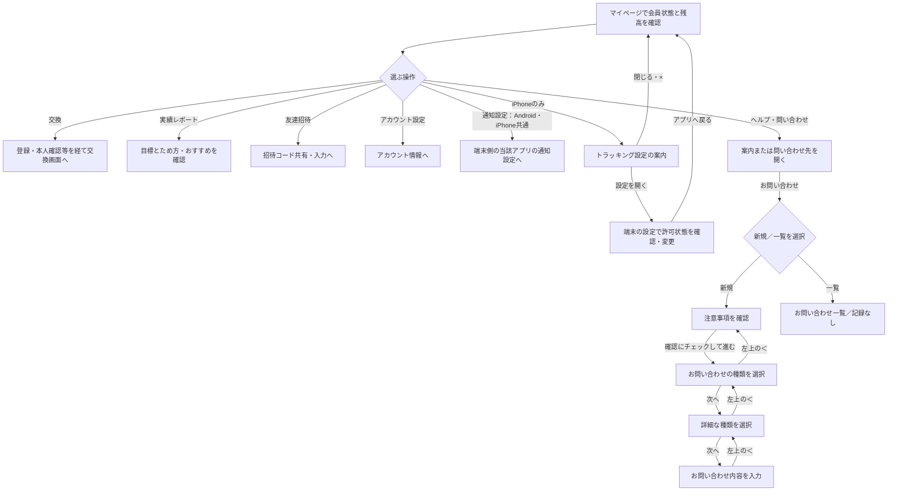

# F18｜マイページ・ヘルプ・問い合わせ PRD（レビュー前）

> ④業務ルールと⑦以降はユーザーレビュー未完了。優先順位はスプレッドシートを正とする。本PRDはTier1のみを定義し、決定した仕様とモックの未反映事項を区別する。

参照するモック：本リポジトリの `mock-app/`・`mock-admin/`（2026-10-27確認）。未接続の外部API・実端末機能は、接続済みとして扱わず末尾に記載する。

| 基本情報 | 内容 |
| --- | --- |
| 機能ID | F18 |
| 概要 | マイページ・ヘルプ・問い合わせ |
| 対象領域 | アプリ／管理画面／外部連携 |
| 関連機能 | [F01](F01-account.md)、[F12](F12-points.md)、[F13](F13-point-exchange.md)、[F14](F14-referral.md) |
| 更新日 | 2026-10-27 |
| 版 | レビュー前（初版未確定） |

## ① 目的・今回作る範囲

目的：利用状況を確認し、困ったときに解決へ進めるようにするため

評価指標：問い合わせ率/解決時間/原因別の問い合わせ件数

優先順位は[アプリ詳細要件のTier列](https://docs.google.com/spreadsheets/d/1tI26I_4vbSHIOzMdJz7g8-DjeLyyVUKoksVHhZ0AQhU/edit#gid=1107057215)を正とする。モックに存在してもTier2・Tier3・空欄の要件は本PRDの定義対象に含めない。

| 要件ID | Tier1の範囲 |
| --- | --- |
| F18-1 | マイページで会員状態（未ログイン/ログイン）とポイント残高を確認できる |
| F18-2 | ログイン済みのユーザーが、マイページから好きなポイントへの交換を開始できる |
| F18-3 | 未ログインのユーザーが、マイページからログイン画面に遷移できる |
| F18-4 | マイページの実績レポートボタンから実績レポート・ポイント履歴へ進める |
| F18-5 | ヘルプ・プライバシーポリシー・利用規約・アクセスデータの利用を外部ページで確認できる。お問い合わせは新規／一覧を選び、注意事項確認→種類→詳細な種類→内容入力へ進める。通知設定はAndroid・iPhoneともに端末側の当該アプリの通知設定へ進める |
| F18-6 | iPhoneユーザーにのみ「トラッキング設定」を表示し、端末の「設定」アプリでトラッキングの許可状態を確認・変更できるようにする。iPhone以外には表示しない |
| F18-7 | アカウント情報を確認してプロフィール確認・ログアウト・アカウント削除へ進むことができる |

要件名に旧モックとの相違がある場合、優先順位は維持し、現在の表示・動きとユーザー指定を②以降へ反映する。実装方式の具体化は仕様設計で扱う。

## ② 画面イメージ

[マイページ](http://127.0.0.1:4222/mock-app/#mypage)／[お問い合わせ](http://127.0.0.1:4222/mock-app/#contact)

- 本人の会員状態・ポイント残高と円相当額・失効予定を確認する。
- 会員は「好きなポイントに交換」、ゲストは会員登録／ログインへ進む。実績レポートのボタンは交換ボタンと同じ横幅にする。
- 友達招待・招待コード入力、ヘルプ・お問い合わせ・アカウント情報の確認・通知設定・トラッキング設定・規約へ進める。
- 「トラッキング設定」の入口・案内画面はiPhoneユーザー限定とし、iPhone以外には表示しない。

「準備中」「交換可能」の内訳は共通スタイルを使い、コイン・最大8桁の数字（カンマ区切り）・ptを各欄の1行に収める。数値は従来の24pxから最大18pxへ縮小し、狭い欄では幅に応じて縮小する。ptは12px、コインは数値と同じ1emとする。

## ③ 操作フロー

## ④ 業務ルール・制約

> ユーザーレビュー未完了。アプリ上の表示に関わるルールを記載する。

### 表示する対象ユーザー

| 対象ユーザー | 利用・表示 |
| --- | --- |
| 会員 | 本人の会員状態・残高と、交換・各設定への入口を表示する |
| 非会員（ゲスト） | 本人の利用状況・残高と、会員登録・ログインへの入口を表示する |

### 表示条件

| 状態・条件 | 表示のルール |
| --- | --- |
| ログイン済み | 主操作として好きなポイントに交換を表示する |
| 非会員 | 主操作として会員登録・ログインを表示する |
| 残高・履歴 | F12の本人データと同じ内容を表示する |
| iPhoneで利用 | 会員・ゲストを問わず「トラッキング設定」を表示する。許可済み・未許可のいずれでも設定を確認できる |
| iPhone以外で利用 | Android・iPad・PCなどには「トラッキング設定」の入口・案内画面を表示しない。無効な項目として残さない |

### 画面に置く要素・操作

| 画面・要素 | 表示・操作のルール |
| --- | --- |
| ポイント表示 | 本人のポイントと円相当額、失効予定を表示する |
| 主操作のボタン | 会員状態に応じて交換または認証へ進む |
| 実績レポート | 交換ボタンと同じ横幅で表示し、レポート・ポイント履歴へ進む |
| 友達招待・招待コード入力 | 招待の共有・入力へ進む |
| アカウント設定 | 本人の情報確認へ進む |
| 通知設定 | Android・iPhoneともに、マイページの「通知設定」から端末側の当該アプリの通知設定画面へ遷移する。アプリ内だけで通知ON／OFFを切り替える画面ではなく、端末側で通知の許可状態を確認・変更する。iPhone限定のトラッキング設定とは表示対象を区別する |
| トラッキング設定（iPhoneのみ） | マイページの入口から案内を開く。端末の「設定」で当該アプリのトラッキング許可状態を確認・変更することを説明し、「設定を開く」で端末設定へ進める |
| トラッキング設定の終了 | 案内の「閉じる」または「×」でマイページへ戻る。閉じる操作だけでは許可状態を変更しない。端末設定からアプリへ戻った場合もマイページへ戻る |
| 許可状態の扱い | 許可・拒否の選択はユーザーが端末側で行う。案内の表示や設定への遷移だけで許可済みと扱わず、端末側の状態に従う |
| ヘルプ・規約 | ヘルプ・プライバシーポリシー・利用規約は、設定された外部ページへWebViewで進む |
| お問い合わせの入口 | マイページの「お問い合わせ」から、新規お問い合わせ／お問い合わせ一覧を選べる画面へ進む。ヘルプ内の問い合わせ入口も同じ画面へ進む |
| お問い合わせの下部ナビ | お問い合わせの入口・注意事項・種類選択・詳細な種類選択・内容入力・一覧では、「マイページ」を選択状態にする。「ホーム」は選択状態にしない |
| 新規お問い合わせ | 注意事項を表示し、「注意事項を確認しました」にチェックを入れるまで「お問い合わせへ」は押せない。チェックを外すと再び押せなくなる。確認後は種類選択→詳細な種類選択→内容入力の順に進む |
| お問い合わせの種類選択 | 各段階で1つ選択して「次へ」で進む。未選択では進めない。種類・詳細な種類の正式な項目と分岐はEDOCODEと相談して決める |
| お問い合わせ入力・戻る | 選択した種類に応じた内容入力へ進む。画面下の「戻る」ボタンは設けず、左上の「＜」で1つ前の画面へ戻る。同じ種類のまま進み直す場合は選択・入力を保持する。種類を変更した場合は、変更先に関係しない後続の選択・入力をリセットする。入力項目・必須条件はEDOCODEと相談して決める |
| お問い合わせ一覧 | 本人のお問い合わせの記録を確認する。記録がない場合は「お問い合わせの記録はまだありません」と表示する |
| アクセスデータの利用 | マイページの「アクセスデータの利用」を選ぶと、詳細を掲載した外部サイトへWebViewで遷移する。詳細説明は遷移先に記載し、アプリ内に独立した説明画面は設けない。トラッキング設定とは別の項目とし、iPhone以外にも表示する |

## ⑤ 管理画面

管理画面のダッシュボードからマイページ・お問い合わせのモックを開ける。問い合わせ内容の編集・送信・履歴取得ができる管理機能とは区別する。

新規作成・変更・削除は、現在の管理画面で操作できる範囲を示す。「外部管理」はNACS・EDOCODE等の担当範囲、「未実装」は操作画面がない項目。削除と公開停止は分けて記載する。

| 対象項目 | 新規作成 | 変更 | 削除 | 管理画面での操作・反映範囲 |
| --- | --- | --- | --- | --- |
| ヘルプ本文・問い合わせ先・規約リンク | 未実装 | 未実装 | 未実装 | 値や表示はアプリに存在するが、現在の管理画面に専用の編集UIはない。 |
| マイページの残高・履歴・交換先 | 対象外 | 対象外 | 対象外 | F12・F13のデータを表示し、本人の操作で遷移する。 |

## ⑥ 例外処理・エラーハンドリング

| 状況 | 表示・処理・復帰 |
| --- | --- |
| 問い合わせ先未設定・外部ページが開けない | 案内と戻る入口を表示する。送信済みとは扱わない。 |
| ゲスト・未認証の制限操作 | 登録・ログイン・本人確認へ進める。 |
| トラッキング設定から端末設定を開けない | iPhoneの「設定」から当該アプリのトラッキング設定を確認するよう案内する。「閉じる」または「×」でマイページへ戻れる。設定を変更できたとは扱わない。 |

## ⑦ 達成条件・未決事項

> 本節以降はユーザーレビュー未完了。

### Tier1の達成条件

- [ ] F18-5：Android・iPhoneの両方で「通知設定」が表示され、選択すると端末側の当該アプリの通知設定画面へ遷移する。
- [ ] 準備中・交換可能が最大8桁の数値（カンマ区切り）・コイン・ptを含め1行で表示される。
- [ ] F18-1：マイページで会員状態（未ログイン/ログイン）とポイント残高を確認できる。
- [ ] F18-2：ログイン済みのユーザーが、マイページから好きなポイントへの交換を開始できる。
- [ ] F18-3：未ログインのユーザーが、マイページからログイン画面に遷移できる。
- [ ] F18-4：マイページの実績レポートボタンから実績レポート・ポイント履歴へ進める。
- [ ] F18-5：ヘルプ・プライバシーポリシー・利用規約・アクセスデータの利用を外部ページで確認できる。
- [ ] F18-5：お問い合わせで新規／一覧を切り替えられる。新規は注意事項の確認チェック後だけ進め、一覧の記録なし状態も確認できる。
- [ ] F18-5：お問い合わせ配下の各画面では、下部ナビの「マイページ」が選択状態となる。
- [ ] F18-5：種類→詳細な種類→内容入力の順に進み、未選択では次へ進めない。画面下に「戻る」ボタンはなく、左上の「＜」で1つ前の画面に戻れる。選択・入力を保持し、種類変更時には後続の内容が残らない。
- [ ] F18-5：「アクセスデータの利用」は端末を問わず表示され、選択すると詳細を掲載した外部サイトへ遷移する。
- [ ] F18-6：iPhoneの会員・ゲストに「トラッキング設定」が表示され、案内から端末設定へ進み、端末側で変更可能な範囲で許可状態を確認・変更できる。
- [ ] F18-6：Android・iPad・PCなどiPhone以外には、トラッキング設定の入口・案内画面が表示されない。
- [ ] F18-6：案内を「閉じる」「×」で閉じると、許可状態を変更せずマイページへ戻る。端末設定を開けない場合も手動操作の案内から戻れる。
- [ ] F18-7：アカウント情報を確認してプロフィール確認・ログアウト・アカウント削除へ進むことができる。
- [ ] ⑥の対象となる空・失敗・中断などの状態から、表示内容と次の操作を確認できる。

### まだ決まっていないこと

| 確認事項 | 相談先 |
| --- | --- |
| 正式な問い合わせ窓口とヘルプ・規約の公開先 | 事業・運用 |
| お問い合わせの注意事項本文、種類・詳細な種類の項目と分岐、入力項目・必須条件、一覧・詳細の表示内容と連携方法 | EDOCODE・事業・運用 |
| 「アクセスデータの利用」の正式な遷移先URL | 事業・運用 |

## モックへの未反映・対象外

### モックへの未反映

| 項目 | 未反映の内容 |
| --- | --- |
| 通知設定 | 現在のモックはアプリ内の通知ON／OFF切替のみ。Android・iPhoneの端末側の当該アプリの通知設定画面への遷移は未反映 |
| 外部ページ・問い合わせ | 本番の問い合わせ先・ヘルプ・規約ページとの接続は未実施 |
| アクセスデータの利用 | 現在のモックは準備中の案内のみ。詳細を掲載した外部サイトへの遷移は未反映。正式な遷移先URLは未決 |
| お問い合わせの送信・履歴 | 新規／一覧、注意事項確認、2段階の種類選択、内容入力・戻るを操作可能。種類・訪問履歴・入力欄は仮の見本であり、確定要件ではない。注意事項は仮置き、一覧は記録なしの見本。送信ボタンは無効で、本番送信・本人の訪問履歴や問い合わせ履歴の取得は未接続。入力は画面間でのみ保持し、再読み込み後の復元は行わない |
| 案内内容の管理画面 | ヘルプ本文・問い合わせ先・規約リンクを編集する専用画面は未実装 |
| トラッキング設定 | 現在は端末によらず入口を表示するため、iPhone限定の表示制御は未反映。案内は「閉じる」のみで、端末設定への遷移・許可状態との連携は未実施。Webモック内では端末の許可状態を変更しない |

### 今回の対象外

| 項目 | 対象外の内容 |
| --- | --- |
| なし | — |

## 変更履歴

| 版 | 日付 | 変更内容 |
| --- | --- | --- |
| レビュー前 | 2026-10-27 | お問い合わせの遷移・入力保持・下部ナビと各設定要件を機能要件表へ同期。通知設定をF18-5に対応付け、アクセスデータの外部遷移の未反映を明記。 |
| レビュー前 | 2026-10-27 | 通知設定はAndroid・iPhoneともに端末側の当該アプリの通知設定へ遷移する要件を明記。 |
| レビュー前 | 2026-10-27 | お問い合わせ配下の下部ナビの選択状態を「マイページ」に統一。 |
| レビュー前 | 2026-10-27 | お問い合わせ画面下の「戻る」を削除し、左上の「＜」で1つ前の画面に戻る操作へ統一。 |
| レビュー前 | 2026-10-27 | 参考画像に沿った種類・詳細な種類の選択から内容入力までの遷移を追加。種類・入力項目はEDOCODEとの相談事項として区別。 |
| レビュー前 | 2026-10-27 | お問い合わせの新規／一覧選択、注意事項の確認後に進む動作と記録なし状態を追加。注意事項本文はEDOCODEとの相談事項とする。 |
| レビュー前 | 2026-10-27 | F18-6をiPhone限定とし、他端末での非表示、設定への遷移・終了、許可状態の扱い、遷移失敗時の案内と達成条件を追加。 |
| レビュー前 | 2026-10-27 | 「アクセスデータの利用」の詳細を外部サイトに掲載し、マイページから遷移する要件を明記。 |
| レビュー前 | 2026-10-23 | マイページの準備中／交換可能の数値を縮小し、ポイント履歴と共通で最大8桁＋ptを1行表示。 ローカルモックへ反映・未push。 |
| レビュー前 | 2026-10-22 | F01に合わせ、F18-7のユーザーに見える呼称を「退会」から「アカウント削除」に変更。 |
| レビュー前 | 2026-10-15 | F10レビューの共通フィードバックを反映。⑤を管理画面へ変更し、④を対象ユーザー・表示条件・配置要素に整理。例外処理と仕様設計事項の重複を除き、未反映と対象外を別表に分離。個別レビューは未完了。 |
