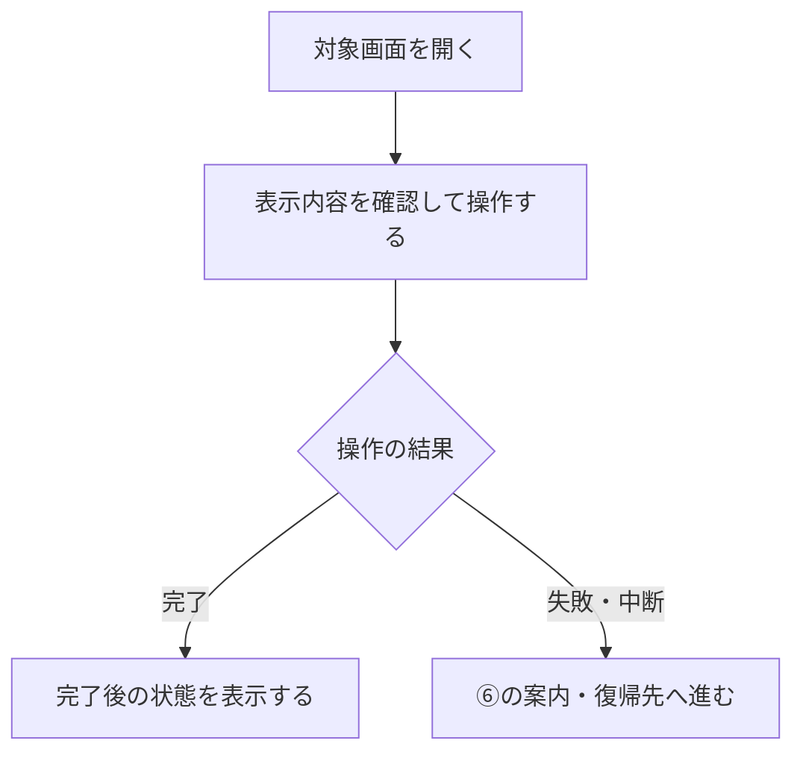

# 【機能ID】｜【機能名】PRD（【レビュー前／第1版】）

> 1機能につき1ファイルで記載します。機能・画面・操作は現在の4189モック、優先順位はスプレッドシートを正とします。ユーザーの指定変更を優先し、PRDはTier1のみを定義します。

**書き方**

- 対象のTier1要件IDを確認し、表示・操作・結果を普段の言葉で記載します。Tier2・Tier3・空欄の機能を、モックにあることだけを理由に含めません。
- 目的は「〜するため」、評価指標は「評価指標：〇〇/〇〇/〇〇」の1行で記載します。
- ③はMermaidの操作フロー図、④はアプリの表示ルール、⑤は管理画面の要件、⑥は例外処理、⑦は達成条件と事業判断の未決事項を記載します。同じ内容を④と⑥に重複させません。
- 画面に置く要素の表は、実際に配置するものだけを記載します。非表示を決めた要素を行として並べません。
- 確定済みの方針を未決に戻しません。認証の引き継ぎ・API方式などの具体化は別途仕様設計で扱い、PRDの未決事項には含めません。
- 表記の共通ルールは[別ファイル](../product/wording-rules.md)で管理します。バナー等の別機能の要件は、その機能のPRDへ集約します。
- モックへの未反映と今回の対象外を別の表にします。反映済みの項目、別ポートへの統合作業、優先順位の対象外一覧、連携先の確認範囲はここに記載しません。
- 初版が未確定の間は「レビュー前（初版未確定）」とし、ユーザーが初版と指定したものを第1版にします。版番号とレビュー状態は分けます。未レビュー表示は明示的な解除指示があるまで残し、版の更新・共通FMTの反映だけで外しません。

| 基本情報 | 記入欄 |
| --- | --- |
| 機能ID | 【F01〜F18の既存IDを維持。新規機能のみ採番ルールに従う】 |
| 概要 | 【1文で記入】 |
| 対象領域 | 【アプリ／管理画面／外部連携等】 |
| 関連機能 | 【関連する個別PRDへのリンク】 |
| 更新日 | 【YYYY-MM-DD】 |
| 版 | 【レビュー前（初版未確定）／第1版】 |

## ① 目的・今回作る範囲

目的：【誰の何をよくするための機能か】

評価指標：【〇〇/〇〇/〇〇】

優先順位は[機能要件表](https://docs.google.com/spreadsheets/d/1g00ZxLGprVNT4T4uSmzw--vRpp95HQ1Uq9i8GnJpmS4/edit)のTier列を確認します。アプリ・管理画面それぞれのTier1を記載し、NACS等の外部システム本体を内製する範囲と混同しません。

| 要件ID | Tier1の範囲 |
| --- | --- |
| 【要件ID】 | 【実現する表示・操作・結果】 |

## ② 画面イメージ

| 画面 | 入口／参照 | 表示・遷移 |
| --- | --- | --- |
| 【画面名】 | 【現在のモックへのリンク】 | 【確認する表示・操作】 |

## ③ 操作フロー

Tier1の入口・操作・分岐・結果を図にします。システム内部の実装方式の検討は図に混ぜません。

## ④ 業務ルール・制約

> ユーザーレビュー未完了。

アプリ上の表示に関わるルールを、以下の3表に分けます。未レビュー表示は明示的な解除指示があるまで残します。

### 表示する対象ユーザー

| 対象ユーザー | 利用・表示 |
| --- | --- |
| 会員 | 【その機能で利用・表示できる範囲】 |
| 非会員（ゲスト） | 【その機能で利用・表示できる範囲】 |

### 表示条件

| 状態・条件 | 表示のルール |
| --- | --- |
| 【例：回答前】 | 【一覧へ表示する条件】 |
| 【例：回答済み・募集終了】 | 【一覧への表示可否】 |

空・取得失敗・中断等の例外時の案内、報酬処理・再試行は⑥に記載します。

### 画面に置く要素・操作

| 画面・要素 | 表示・操作のルール |
| --- | --- |
| 【見出し・タイル等】 | 【表示内容・押したときの遷移】 |

## ⑤ 管理画面

実際の管理画面に基づき、新規作成・変更・削除を別々に記載します。停止と削除、設定値の存在と操作UIの実装は区別します。

| 対象項目 | 新規作成 | 変更 | 削除 | 管理画面での操作・反映範囲 |
| --- | --- | --- | --- | --- |
| 【対象項目】 | 【可能／不可／外部管理／未実装／対象外】 | 【同左】 | 【同左】 | 【実際の画面、入力範囲・条件、反映タイミング】 |

「外部管理」はNACS・EDOCODE等の担当範囲、「未実装」は操作UIがない項目です。管理画面が不要な場合は管理元と理由を記載します。

## ⑥ 例外処理・エラーハンドリング

| 状況 | 表示・処理・復帰 |
| --- | --- |
| 【読込中・該当なし・取得失敗等】 | 【表示する案内と次の操作】 |
| 【中断・上限・重複操作等】 | 【結果・報酬の扱いと復帰先】 |

## ⑦ 達成条件・未決事項

> 本節以降はユーザーレビュー未完了。

### Tier1の達成条件

- [ ] 【要件ID】：【操作して確認できる表示・結果】
- [ ] 【管理画面の操作可否と反映範囲を確認できる】
- [ ] 【⑥の例外状態で案内と復帰を確認できる】

### まだ決まっていないこと

| 確認事項 | 相談先 |
| --- | --- |
| 【Tier1の表示・体験・事業判断として未決の内容。なければ「なし」】 | 【相談先】 |

確定済みの内容や、具体的な認証・API方式は並べません。

## モックへの未反映・対象外

### モックへの未反映

| 項目 | 未反映の内容 |
| --- | --- |
| 【項目／なし】 | 【今回のTier1要件のうち未反映・未接続の内容のみ】 |

### 今回の対象外

| 項目 | 対象外の内容 |
| --- | --- |
| 【項目／なし】 | 【今回の機能定義から明示的に除く範囲。なければ「—」】 |

## 変更履歴

| 版 | 日付 | 変更内容 |
| --- | --- | --- |
| 【レビュー前／第1版】 | 【YYYY-MM-DD】 | 【共通修正／ユーザーが初版と指定した範囲。未レビューの箇所は維持】 |

ユーザーが初版と指定するまでは版を確定しません。第1版にした場合も未レビュー箇所の表示は残します。過去の経緯はGit履歴で確認します。
